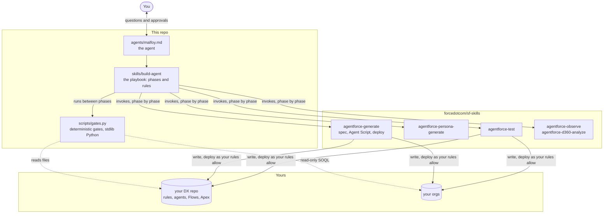

<h1 align="center">Malfoy</h1>

<p align="center"><b>He will not ship your untested Agentforce agent.</b></p>

<p align="center">
An exacting senior engineer for Salesforce Agentforce, living in Claude Code.<br>
From "I need an agent that…" to tested and activation-ready, with a gate between every phase.
</p>

<p align="center">
  <a href="https://github.com/GooddyLife/malfoy/stargazers"></a>
  <a href="https://github.com/GooddyLife/malfoy/actions/workflows/test.yml"></a>
  <a href="LICENSE"></a>
  
</p>

<p align="center">
  
</p>

<p align="center"><sub>Illustration. The <code>PASS</code>, <code>FAIL</code> and <code>READY</code> lines are the real output of <code>gates.py</code> on <a href="examples/order-status">the example in this repo</a>.</sub></p>

## Install

Inside Claude Code, as two separate prompts:

```
/plugin marketplace add GooddyLife/malfoy
```

```
/plugin install malfoy@malfoy
```

Then start a session as Malfoy, from the root of your Salesforce DX project:

```bash
claude --agent malfoy
```

and tell him what you need. Already in a session? `/malfoy:build-agent` runs the same playbook.

On first use he checks that the `agentforce-*` skills from [forcedotcom/sf-skills](https://github.com/forcedotcom/sf-skills) are installed, and offers to install them if they are not.

## The official skills, with and without him

Malfoy runs on top of Salesforce's own [`agentforce-*` skills](https://github.com/forcedotcom/sf-skills). They do the building. This is what changes when someone conducts them.

<p align="center">
  
</p>

<details>
<summary>The same comparison as a table, with the full wording</summary>

| | The official skills on their own | The same skills, conducted by Malfoy |
|---|---|---|
| **Where you start** | Nine skills. You choose which one, and when | One entry point, eight phases, a fixed order |
| **Persona** | A separate skill that the build skill never mentions | Phase 3. Not skipped |
| **When a phase is done** | When the model judges it so: "do not proceed through a blocking result" | When a script exits 0 |
| **The spec** | Purpose, behaviour, subagents, actions | The same, plus success metric, out of scope, handoff, data and privacy, environments. Rejected while a section is empty or nothing says what the agent must refuse |
| **Tests against the spec** | "Test coverage maps against it", in prose | Use cases have IDs. `coverage` names the one with no test |
| **The user the agent runs as** | A setup guide, with queries to run | `perms` checks that user's access to every Apex class the agent calls, in the org |
| **What the compiler stays quiet about** | Reference pages to read | `lint`: seven rules, with file and line |
| **"It's active"** | A query in the docs | `active`, pass or fail, before he says the word |
| **A file edited after its check passed** | Nothing records it | `STALE` |
| **Which spec shipped as which version** | The spec is saved in the project; nothing ties it to the version published | `active` records the version, the hash of the spec, tests and agent, and the commit. `status` shows `DRIFT` |
| **Your repo's deploy and approval rules** | Not looked for | Read first. They override his |

</details>

<sub>Compared against forcedotcom/sf-skills at commit <code>788b83f</code> (v1.70.0) on 16 Nov 2026. <a href="docs/comparison.md">How each row was checked.</a> This compares what is enforced, it is not a benchmark of results. The official skills do everything that actually builds the agent: the Agent Script, the persona, the tests, the observability. Malfoy writes none of that.</sub>

## How it works

Eight phases. He does not skip, and he says which one he is in.

| # | Phase | What happens | He will not move on until |
|---|-------|--------------|---------------------------|
| 0 | Read the repo | Finds your packages, existing agents, rule files, CI and orgs, and reads the rules | `doctor` passes and he has a profile of your repo |
| 1 | Discovery | Product-owner questions: the one job, use cases, what to refuse, handoff, data, environments | `spec` passes and you approve the spec |
| 2 | Architecture | Subagents, what is deterministic, which existing Flows and Apex become actions | `spec` passes again |
| 3 | Persona | Voice, tone, guardrails, scored | the score meets the minimum you agreed |
| 4 | Build | Writes the Agent Script, compiles it | compile is clean, `lint` and `perms` pass |
| 5 | Test | Preview with traces, Testing Center suite, security probing | `coverage` passes and every test passes on trace evidence |
| 6 | Release | Sandbox, then staging, then production, each by your rules | `status` is `READY`; `active` proves the version, per org |
| 7 | Observe | Reads real sessions once they exist | optional |

People new to Agentforce get one question at a time, with an example answer. People who hand him a finished spec get it checked, not re-asked. The gates are the same for both.

### Architecture

Malfoy conducts. He does not re-implement the Salesforce skills; he decides their order and checks their work.



### The gates

One file, standard library only, Python 3.9+. It reads; it never writes to an org.

| Gate | Fails when |
|------|-----------|
| `doctor` | the Salesforce CLI or a required upstream skill is missing |
| `spec` | a section is missing or empty, a template placeholder survived, use cases have no IDs, or nothing says what the agent must refuse |
| `lint` | the `.agent` has a pitfall the compiler stays quiet about: no declared locale, a user ID where a username belongs, a service agent with no agent user. Warns on `#` lines inside a `\|` block (they are prompt text, not comments) and hardcoded record IDs |
| `coverage` | a use case in the spec has no test tagged with its ID |
| `perms` | the agent user is missing or inactive, cannot reach an Apex class an action targets, or a Flow target is missing or has no active version |
| `active` | the agent has no active version in the org, or not the one you expected. On a pass it records which spec, tests and agent file shipped as that version, with the commit |
| `status` | any required gate failed, never ran, or passed on a file that has changed since. Also shows, per org, whether the files still match the last release (`SHIPPED`) or have moved on (`DRIFT`) |

Real output, from [`examples/order-status`](examples/order-status):

```console
$ python skills/build-agent/scripts/gates.py spec spec.md --state state.json
NOTE  spec  1 of 1 action(s) still to build (fine now, an error with --final)
PASS  spec  0 error(s), 0 warning(s)
$ python skills/build-agent/scripts/gates.py lint OrderStatus.agent --state state.json
PASS  lint  0 error(s), 0 warning(s)
$ python skills/build-agent/scripts/gates.py coverage spec.md tests.yaml --state state.json
PASS  coverage  0 error(s), 0 warning(s)

$ echo "" >> tests.yaml      # someone touches the tests after they passed
$ python skills/build-agent/scripts/gates.py status state.json
PASS    spec      2026-11-16T17:01:51+00:00
PASS    lint      2026-11-16T17:01:51+00:00
STALE   coverage  2026-11-16T17:01:51+00:00
NOT READY: fix the gates above, then run them again
```

You can run the gates without Malfoy, in CI or by hand. He would approve.

## Example, end to end

[`examples/order-status`](examples/order-status) follows one small agent through the phases: the request, the questions, the spec, the Agent Script, the tests, and the output of each gate. The store, the customers and the orders in it are made up.

## What he refuses to do

- Activate anything in production without your yes, naming the agent and the version.
- Say "tested", "deployed" or "active" without the output that shows it.
- Guess an answer you did not give. If he cannot ask, he returns the open questions and stops.
- Put real customer data in a spec, a test or an example.
- Override your repository's rules with his own.

## Status

Version 0.1. What has been checked, and what has not:

- **Checked:** the gates have unit tests that run on Linux, macOS and Windows on every push. Each test breaks the example in one way and expects the right gate to say so.
- **Checked:** `perms` and `active` were run against a real sandbox, read-only, including the failing paths.
- **Checked:** the example `.agent` compiles with no diagnostics on the Agent Script compiler 2.9.27.
- **Not yet:** a complete run recorded from discovery to a production activation. The org steps in the example are described, not recorded.
- **Not checked by any gate:** field and object permissions for what each action reads or writes. `perms` says so every time it runs.

No gate can promise an agent with no problems in production. They remove the failures that are known and checkable; how the model behaves with real users is what phase 7 is for.

## Requirements

- [Claude Code](https://claude.com/claude-code)
- [Salesforce CLI](https://developer.salesforce.com/tools/salesforcecli) (`sf`), authenticated to the orgs you work with
- Python 3.9 or newer
- An org with Agentforce enabled, for everything from phase 4 on
- The `agentforce-*` skills from [forcedotcom/sf-skills](https://github.com/forcedotcom/sf-skills) (he installs them on request)

Using another coding agent? The playbook is a plain [Agent Skill](skills/build-agent/SKILL.md) and the gates are a plain Python script. They work wherever skills do; the `malfoy` agent definition is specific to Claude Code.

## FAQ

**Does it replace the Salesforce skills?** No. It needs them. They know how to do each step; Malfoy decides the order and refuses to take their word for it.

**Why would I want an agent that says no?** Because the alternative says yes, and you find out in production.

**Does it work on Windows?** Yes. The gates are tested there on every push.

**Why "Malfoy"?** Exacting, proud, and insufferable about standards. The resemblance ends there: he is on your side.

## Contributing

Found a way an agent fails in production that a script could have caught? That is the contribution this project wants most. See [CONTRIBUTING.md](CONTRIBUTING.md).

## If he caught something before your customers did

A star is how he keeps score. He would never ask. We will.

<p align="center">
  <a href="https://github.com/GooddyLife/malfoy/stargazers"></a>
</p>

<p align="center">
  <a href="https://www.star-history.com/gooddylife/malfoy#history">
    <picture>
      <source media="(prefers-color-scheme: dark)" srcset="https://api.star-history.com/chart?repos=GooddyLife/malfoy&type=Date&theme=dark" />
      <source media="(prefers-color-scheme: light)" srcset="https://api.star-history.com/chart?repos=GooddyLife/malfoy&type=Date" />
      
    </picture>
  </a>
</p>

## License

[MIT](LICENSE). Not affiliated with or endorsed by Salesforce. "Malfoy" is a nod to a fictional character; this project is not affiliated with or endorsed by its rights holders. The upstream skills belong to their authors and are fetched from their repository, not redistributed here.
