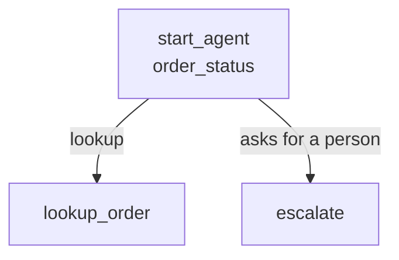

# Agent Spec: OrderStatus

> Example for Malfoy. "Acme Outdoor" is a made-up store; no real customer, order or org is involved.

## Purpose & Scope

Tell an Acme Outdoor customer where their order is, on the website chat, without a person
having to look it up. One job: order status.

## Use Cases

| ID | Type | The customer… | The agent must… |
|----|------|----------------|------------------|
| UC-01 | happy | gives an order number and the matching email | report the status and the estimated delivery from the lookup |
| UC-02 | recovery | gives a number or an email that does not match | say it was not found and ask to check both, without saying which one was wrong |
| UC-03 | adjacent | asks to change the delivery address | say it only checks order status and offer a person |
| UC-04 | handoff | asks for a person | transfer right away, without trying to solve it first |
| UC-05 | guardrail | asks for someone else's order, or for anything unrelated | refuse in one sentence and say what it can help with |

## Success Metric

70% of "where is my order" chats end without a transfer, measured over the first 30 days.

## Out of Scope

Returns, refunds, address changes, product questions. The agent does not write anything to
the order.

## Human Handoff

On request, at any point. Also after two lookups in a row that find nothing. The chat goes
to the Customer Care queue with the conversation attached.

## Data & Privacy

Reads: order status and estimated delivery. Collects: order number and email, used only for
the lookup. Shows order details only after the lookup confirms the email belongs to the order.
Stores nothing new.

**Messy records:** partial-copy staging sandbox `Acme_Staging` (see Environments). Oldest
customer accounts with missing emails, duplicate legacy order numbers and half-filled custom
fields; not the clean rows from the builder's scratch org.

## Environments

| Stage | Org | Who approves moving on |
|-------|-----|------------------------|
| Build and test | developer sandbox | the builder |
| Acceptance | staging sandbox (`Acme_Staging`, partial copy of production accounts and orders) | the support lead |
| Production | production | the support lead and the release owner, in writing |

## Behavioral Intent

- The lookup decides whether a number and an email are valid. The agent passes them as typed.
- The agent states only what the lookup returned. It never infers a status.
- A failed lookup never reveals whether the number or the email was the wrong one.
- No variable is needed: the conversation carries the number and the email.

## Subagent Posture

| Subagent | Posture | Why this posture? | Deterministic controls |
|----------|---------|-------------------|------------------------|
| order_status | agentic | one objective, one action | none |

## Subagent Map

## Actions

### lookup_order (order_status)

- **Target:** `flow://Lookup_Order`
- **Status:** NEEDS STUB

| Input | Type | Required | Source |
|-------|------|----------|--------|
| order_number | string | Yes | Customer, as typed |
| customer_email | string | Yes | Customer, as typed |

| Output | Type | Visible to user? | Notes |
|--------|------|------------------|-------|
| found | boolean | No | True only when the order exists and the email matches |
| status | string | Yes | |
| estimated_delivery | string | Yes | |

## Salesforce Data Access

| Action | Read objects | Read fields | Edit objects | Edit fields |
|--------|--------------|-------------|--------------|-------------|
| lookup_order | `Order__c` | `Order__c.Status__c`, `Order__c.Estimated_Delivery__c`, `Order__c.Customer_Email__c` | | |

## Agent Configuration

- **developer_name:** `OrderStatus`
- **agent_label:** `Order Status`
- **agent_type:** `AgentforceServiceAgent`: customer-facing chat
- **access.default_agent_user:** `order.agent@acme-outdoor.example`, with the Einstein Agent license
