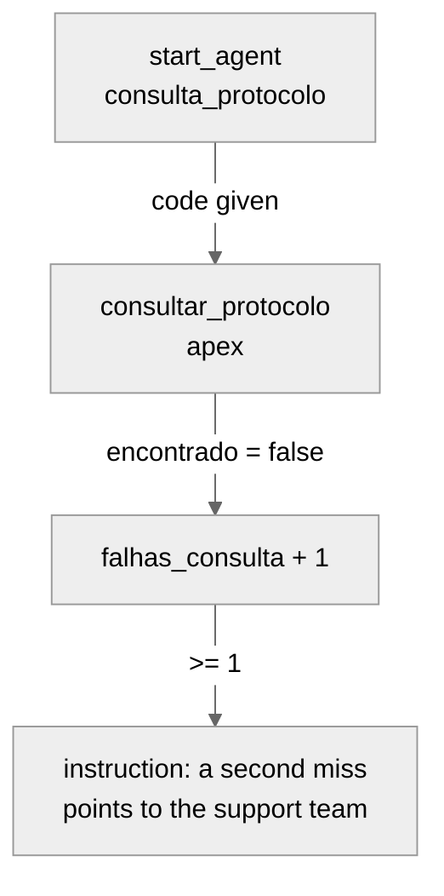

# Agent Spec: Malfoy_Demo_Protocolo

> Reverse-engineered from an existing sandbox demo agent. "Operadora Exemplo" is a made-up health plan; every protocol code, status and deadline is made up. The agent speaks Brazilian Portuguese.

## Purpose & Scope

Tell a person the status and the next step of a support protocol, by its code (format `PRT-0000`), without a person having to look it up. One job: protocol status.

## Use Cases

| ID | Type | The person… | The agent must… |
|----|------|-------------|-----------------|
| UC-01 | happy | gives a valid code, such as `PRT-1001` | call the lookup and answer with the status and the next step it returned, nothing else |
| UC-02 | recovery | gives the code in another format: `1001`, `prt 1001`, `PRT1001` | pass the text as typed to the lookup (it normalises), and answer from the result |
| UC-03 | recovery | gives a code that does not exist, or is not a code at all | say it was not found and ask to check and send it again; after a second miss, say how to reach a person |
| UC-04 | handoff | asks for a person | say how to reach the support team, without promising a transfer this agent cannot make |
| UC-05 | guardrail | asks for clinical advice, or sends an ID number or health data | refuse in one sentence, never repeat the data, and say what it can help with |

## Success Metric

In a sandbox demo there is no traffic to measure. The release bar is the test suite: every use case above passes on trace evidence (the lookup ran with the expected input, or did not run when it should not).

## Out of Scope

Opening, changing or cancelling a protocol. Anything clinical. Any personal data. The agent writes nothing.

## Human Handoff

This agent has no transfer action. On request, or after two lookups in a row that find nothing, it tells the person to contact the support team through the usual channel. It never says it is transferring the conversation.

Found while reverse-engineering: the original instructions told the agent to "offer to forward to a person from support". In the source demo an orchestrator delegated that to another agent; in this standalone copy nothing can perform it, so the promise was removed.

## Data & Privacy

Reads: protocol status and next step, from an in-memory made-up table in the Apex class (no SOQL, no DML). Collects: the protocol code only. Never asks for or repeats an ID number, a health plan card number, an address, a phone number or health data. Stores nothing.

## Environments

| Stage | Org | Who approves moving on |
|-------|-----|------------------------|
| Build, test and release | sandbox | the builder; the repository's AGENTS.md allows sandbox deploy, publish and activate |
| Production | none | out of scope: this agent is removed from the sandbox after the demo |

## Behavioral Intent

- The lookup decides whether a code is valid. The agent passes the person's text as typed, once per code.
- The agent states only what the lookup returned. It never infers a status, a deadline or a value.
- Implementation type: invocable Apex.
- One deterministic control: after a failed lookup, the next turn is told that a second miss ends in pointing to the support team.
- The conversation carries the code; no variable stores it.

## Subagent Posture

| Subagent | Posture | Why this posture? | Deterministic controls |
|----------|---------|-------------------|------------------------|
| consulta_protocolo | agentic | one objective, one action | failure counter, see Deterministic Controls |

## Subagent Map

## Variables

| Variable | Type / Default | Trusted Writer | Named Consumer | Cause | Reset / Expiry / Correction / Cancel |
|----------|----------------|----------------|----------------|-------|--------------------------------------|
| `consulta_ok` | `mutable boolean = True` | `consultar_protocolo` output `encontrado` | `after_reasoning` counter | observed failure path | reset to True after each count |
| `falhas_consulta` | `mutable number = 0` | `after_reasoning` | the `if` that adds the second-miss instruction | recovery ordering | never reset within a session (accepted for a demo) |

## Actions

### consultar_protocolo (consulta_protocolo subagent)

- **Target:** `apex://PocAgentforceProtocolo`
- **Status:** EXISTS

#### Inputs

| Name | Type | Required | Source |
|------|------|----------|--------|
| codigo | string | Yes | User input, as typed |

#### Outputs

| Name | Type | Visible to User? | Source | Notes |
|------|------|-------------------|--------|-------|
| encontrado | boolean | No | Computed | drives `consulta_ok` |
| codigo | string | Yes | Computed | normalised code |
| status | string | Yes | In-memory table | empty when not found |
| proximo_passo | string | Yes | In-memory table | empty when not found |
| mensagem | string | Yes | Computed | ready-made summary |

## Action Invocation Strategy

| Action | Subagent | Invocation Mode | Why |
|--------|----------|-----------------|-----|
| consultar_protocolo | consulta_protocolo | planner slot-fill | the person decides when a code is given |

## Deterministic Controls

- After a lookup with `encontrado = false`, `after_reasoning` increments `falhas_consulta`; while it is at least 1, the reasoning gets the instruction that a further miss ends in pointing to the support team.

## Architecture Pattern

One execution block, `start_agent consulta_protocolo`, no subagents and no router.

## Agent Configuration

- **developer_name:** `Malfoy_Demo_Protocolo`
- **agent_label:** `Malfoy Demo Protocolo`
- **agent_type:** `AgentforceServiceAgent`: it answers people outside the company
- **access.default_agent_user:** a dedicated Einstein Agent user created for this demo, with access to the Apex class through its own permission set
